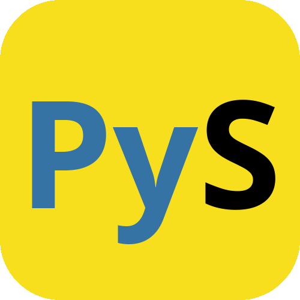

# PyScript

<div align="center">
    
    <br>
    <a href="https://pepy.tech/project/pyscript-programming-language">
        
    </a>
    <a href="https://en.wikipedia.org/wiki/MIT_License">
        
    </a>
    <a href="https://www.python.org/">
        
    </a>
</div>

PyScript is a programming language built on top of Python. It combines some syntax from Python and JavaScript, so if
you're already familiar with Python, JavaScript or both, it should be quite easy to learn.

## Introduction 📖
The name of "PyScript" was previously used by a well-known framework designed to run Python directly in the browser.
Designed from the outset with inspiration from both Python and JavaScript, this language emphasizes human readability.
Its name was derived by combining **Py**thon and Java**Script**. Please note that this language is an independent
programming language project written in Python and has no affiliation with the aforementioned PyScript framework.

This language wasn't designed to compete with other modern programming languages, but rather as a learning for
understanding how programming languages ​​work and how human written code can be understood by machines. Furthermore, this
language was created as a relatively complex project. Using Python as the foundation for PyScript, it's easy to
understand how the language is built without having to understand complex instructions like those in C, C++, and other
low-level languages.

To learn more about PyScript, you can see on [PyScript documentation](https://azzammuhyala.github.io/pyscript) or 
[PyScript repository](https://github.com/azzammuhyala/pyscript) for full source code.

## Try PyScript ▶️
Try [PyScript Shell (_REPL_)](https://azzammuhyala.github.io/pyscript/shell.html) inside your browser directly
(no installation required).

## Installation ⬇️
First, you'll need to download Python. Make sure you're using the latest version above `3.10`, to ensure the code runs
correctly. Visit the official [Python website](https://python.org) to download it.

Next, after downloading and configuring the Python application, you can download the PyScript from
[PyScript releases](https://github.com/azzammuhyala/pyscript/releases) or from PIP with this command (_Recommended_):
```sh
pip install -U pyscript-programming-language
```

[_OPTIONAL_] You can download additional libraries that PyScript requires with this command:
```sh
pip install -U pyscript-programming-language[other]
```

And also, you can download PyScript with `git`:
```sh
git clone https://github.com/azzammuhyala/pyscript
cd pyscript
pip install .
```

After that, you can run the PyScript shell (_REPL_) with this command:
```sh
python -m pyscript
```
If successful, you can see the version, release date, and a `>>>` like Python shell (_REPL_).

## Example 📜
Familiar? There it is!
<div class="pys-code"><pre><span class="c-comment"># get a number and operator with input()</span><span class="c-default"><br></span><span class="c-identifier">a</span><span class="c-default"> = </span><span class="c-identifier-type">float</span><span class="c-brackets-0">(</span><span class="c-identifier-function">input</span><span class="c-brackets-1">(</span><span class="c-string">&quot;Enter a first number : &quot;</span><span class="c-brackets-1">)</span><span class="c-brackets-0">)</span><span class="c-default"><br></span><span class="c-identifier">b</span><span class="c-default"> = </span><span class="c-identifier-type">float</span><span class="c-brackets-0">(</span><span class="c-identifier-function">input</span><span class="c-brackets-1">(</span><span class="c-string">&quot;Enter a second number: &quot;</span><span class="c-brackets-1">)</span><span class="c-brackets-0">)</span><span class="c-default"><br></span><span class="c-identifier">operation</span><span class="c-default"> = </span><span class="c-identifier-function">input</span><span class="c-brackets-0">(</span><span class="c-string">&quot;Enter an operation (+, -, *, /): &quot;</span><span class="c-brackets-0">)</span><span class="c-default"><br><br></span><span class="c-comment"># define a functions</span><span class="c-default"><br></span><span class="c-keyword-constant">func</span><span class="c-default"> </span><span class="c-identifier-function">add</span><span class="c-brackets-0">(</span><span class="c-identifier">a</span><span class="c-default">, </span><span class="c-identifier">b</span><span class="c-brackets-0">)</span><span class="c-default"> </span><span class="c-brackets-0">{</span><span class="c-default"><br></span><span class="c-default">    </span><span class="c-keyword">return</span><span class="c-default"> </span><span class="c-identifier">a</span><span class="c-default"> + </span><span class="c-identifier">b</span><span class="c-default"><br></span><span class="c-brackets-0">}</span><span class="c-default"><br><br></span><span class="c-keyword-constant">func</span><span class="c-default"> </span><span class="c-identifier-function">sub</span><span class="c-brackets-0">(</span><span class="c-identifier">a</span><span class="c-default">, </span><span class="c-identifier">b</span><span class="c-brackets-0">)</span><span class="c-default"> </span><span class="c-brackets-0">{</span><span class="c-default"><br></span><span class="c-default">    </span><span class="c-keyword">return</span><span class="c-default"> </span><span class="c-identifier">a</span><span class="c-default"> - </span><span class="c-identifier">b</span><span class="c-default"><br></span><span class="c-brackets-0">}</span><span class="c-default"><br><br></span><span class="c-keyword-constant">func</span><span class="c-default"> </span><span class="c-identifier-function">mul</span><span class="c-brackets-0">(</span><span class="c-identifier">a</span><span class="c-default">, </span><span class="c-identifier">b</span><span class="c-brackets-0">)</span><span class="c-default"> </span><span class="c-brackets-0">{</span><span class="c-default"><br></span><span class="c-default">    </span><span class="c-keyword">return</span><span class="c-default"> </span><span class="c-identifier">a</span><span class="c-default"> * </span><span class="c-identifier">b</span><span class="c-default"><br></span><span class="c-brackets-0">}</span><span class="c-default"><br><br></span><span class="c-keyword-constant">func</span><span class="c-default"> </span><span class="c-identifier-function">floordiv</span><span class="c-brackets-0">(</span><span class="c-identifier">a</span><span class="c-default">, </span><span class="c-identifier">b</span><span class="c-brackets-0">)</span><span class="c-default"> </span><span class="c-brackets-0">{</span><span class="c-default"><br></span><span class="c-default">    </span><span class="c-comment"># check b is zero</span><span class="c-default"><br></span><span class="c-default">    </span><span class="c-keyword">return</span><span class="c-default"> </span><span class="c-identifier">b</span><span class="c-default"> != </span><span class="c-number">0</span><span class="c-default"> ? </span><span class="c-identifier">a</span><span class="c-default"> / </span><span class="c-identifier">b</span><span class="c-default"> : </span><span class="c-keyword-constant">none</span><span class="c-default"><br></span><span class="c-brackets-0">}</span><span class="c-default"><br><br></span><span class="c-comment"># operation matching</span><span class="c-default"><br></span><span class="c-keyword">switch</span><span class="c-default"> </span><span class="c-brackets-0">(</span><span class="c-identifier">operation</span><span class="c-default">.</span><span class="c-identifier-function">strip</span><span class="c-brackets-1">()</span><span class="c-brackets-0">)</span><span class="c-default"><br></span><span class="c-brackets-0">{</span><span class="c-default"><br></span><span class="c-default">    </span><span class="c-keyword">case</span><span class="c-default"> </span><span class="c-string">&#x27;+&#x27;</span><span class="c-default">:</span><span class="c-default"><br></span><span class="c-default">        </span><span class="c-identifier">result</span><span class="c-default"> = </span><span class="c-identifier-function">add</span><span class="c-brackets-1">(</span><span class="c-identifier">a</span><span class="c-default">, </span><span class="c-identifier">b</span><span class="c-brackets-1">)</span><span class="c-default"><br></span><span class="c-default">        </span><span class="c-identifier-function">print</span><span class="c-brackets-1">(</span><span class="c-string">&quot;Result of {:,} + {:,} = {:,}&quot;</span><span class="c-default">.</span><span class="c-identifier-function">format</span><span class="c-brackets-2">(</span><span class="c-identifier">a</span><span class="c-default">, </span><span class="c-identifier">b</span><span class="c-default">, </span><span class="c-identifier">result</span><span class="c-brackets-2">)</span><span class="c-brackets-1">)</span><span class="c-default"><br></span><span class="c-default">        </span><span class="c-keyword">break</span><span class="c-default"><br><br></span><span class="c-default">    </span><span class="c-keyword">case</span><span class="c-default"> </span><span class="c-string">&#x27;-&#x27;</span><span class="c-default">:</span><span class="c-default"><br></span><span class="c-default">        </span><span class="c-identifier">result</span><span class="c-default"> = </span><span class="c-identifier-function">sub</span><span class="c-brackets-1">(</span><span class="c-identifier">a</span><span class="c-default">, </span><span class="c-identifier">b</span><span class="c-brackets-1">)</span><span class="c-default"><br></span><span class="c-default">        </span><span class="c-identifier-function">print</span><span class="c-brackets-1">(</span><span class="c-string">&quot;Result of {:,} - {:,} = {:,}&quot;</span><span class="c-default">.</span><span class="c-identifier-function">format</span><span class="c-brackets-2">(</span><span class="c-identifier">a</span><span class="c-default">, </span><span class="c-identifier">b</span><span class="c-default">, </span><span class="c-identifier">result</span><span class="c-brackets-2">)</span><span class="c-brackets-1">)</span><span class="c-default"><br></span><span class="c-default">        </span><span class="c-keyword">break</span><span class="c-default"><br><br></span><span class="c-default">    </span><span class="c-keyword">case</span><span class="c-default"> </span><span class="c-string">&#x27;*&#x27;</span><span class="c-default">:</span><span class="c-default"><br></span><span class="c-default">        </span><span class="c-identifier">result</span><span class="c-default"> = </span><span class="c-identifier-function">mul</span><span class="c-brackets-1">(</span><span class="c-identifier">a</span><span class="c-default">, </span><span class="c-identifier">b</span><span class="c-brackets-1">)</span><span class="c-default"><br></span><span class="c-default">        </span><span class="c-identifier-function">print</span><span class="c-brackets-1">(</span><span class="c-string">&quot;Result of {:,} * {:,} = {:,}&quot;</span><span class="c-default">.</span><span class="c-identifier-function">format</span><span class="c-brackets-2">(</span><span class="c-identifier">a</span><span class="c-default">, </span><span class="c-identifier">b</span><span class="c-default">, </span><span class="c-identifier">result</span><span class="c-brackets-2">)</span><span class="c-brackets-1">)</span><span class="c-default"><br></span><span class="c-default">        </span><span class="c-keyword">break</span><span class="c-default"><br><br></span><span class="c-default">    </span><span class="c-keyword">case</span><span class="c-default"> </span><span class="c-string">&#x27;/&#x27;</span><span class="c-default">:</span><span class="c-default"><br></span><span class="c-default">        </span><span class="c-identifier">result</span><span class="c-default"> = </span><span class="c-identifier-function">floordiv</span><span class="c-brackets-1">(</span><span class="c-identifier">a</span><span class="c-default">, </span><span class="c-identifier">b</span><span class="c-brackets-1">)</span><span class="c-default"><br></span><span class="c-default">        </span><span class="c-identifier-function">print</span><span class="c-brackets-1">(</span><span class="c-string">&quot;Result of {:,} / {:,} = {}&quot;</span><span class="c-default">.</span><span class="c-identifier-function">format</span><span class="c-brackets-2">(</span><span class="c-default"><br></span><span class="c-default">            </span><span class="c-identifier">a</span><span class="c-default">, </span><span class="c-identifier">b</span><span class="c-default">,</span><span class="c-default"><br></span><span class="c-default">            </span><span class="c-identifier">result</span><span class="c-default"> </span><span class="c-keyword-constant">is</span><span class="c-default"> </span><span class="c-keyword-constant">not</span><span class="c-default"> </span><span class="c-keyword-constant">none</span><span class="c-default"> ? </span><span class="c-identifier-function">format</span><span class="c-brackets-0">(</span><span class="c-identifier">result</span><span class="c-default">, </span><span class="c-string">&#x27;,&#x27;</span><span class="c-brackets-0">)</span><span class="c-default"> : </span><span class="c-string">&quot;Cannot be divided by 0&quot;</span><span class="c-brackets-2">)</span><span class="c-default"><br></span><span class="c-default">        </span><span class="c-brackets-1">)</span><span class="c-default"><br></span><span class="c-default">        </span><span class="c-keyword">break</span><span class="c-default"><br><br></span><span class="c-default">    </span><span class="c-keyword">default</span><span class="c-default">:</span><span class="c-default"><br></span><span class="c-default">        </span><span class="c-identifier-function">print</span><span class="c-brackets-1">(</span><span class="c-string">&quot;Unknown operation&quot;</span><span class="c-brackets-1">)</span><span class="c-default"><br></span><span class="c-brackets-0">}</span></pre></div>

## Library Requirements 📓
| No | Name              | Status                 |
|:--:|:------------------|:----------------------:|
| 1  | `argparse`        | **required**           |
| 2  | `builtins`        | **required**           |
| 3  | `cmath`           | **required**           |
| 4  | `collections.abc` | **required**           |
| 5  | `difflib`         | **required**           |
| 6  | `functools`       | **required**           |
| 7  | `html`            | **required**           |
| 8  | `importlib`       | **required**           |
| 9  | `inspect`         | **required**           |
| 10 | `io`              | **required**           |
| 11 | `itertools`       | **required**           |
| 12 | `json`            | **required**           |
| 13 | `operator`        | **required**           |
| 14 | `os`              | **required**           |
| 15 | `pkgutil`         | **required**           |
| 16 | `re`              | **required**           |
| 17 | `subprocess`      | **required**           |
| 18 | `sys`             | **required**           |
| 19 | `types`           | **required**           |
| 20 | `typing`          | **required**           |
| 21 | `unicodedata`     | **required**           |
| 1  | `ast`             | **required (library)** |
| 2  | `math`            | **required (library)** |
| 3  | `msvcrt`          | **required (library)** |
| 4  | `pprint`          | **required (library)** |
| 5  | `shutil`          | **required (library)** |
| 6  | `signal`          | **required (library)** |
| 7  | `stat`            | **required (library)** |
| 8  | `termios`         | **required (library)** |
| 9  | `time`            | **required (library)** |
| 10 | `tty`             | **required (library)** |
| 1  | `_colorize`       | **optional**           |
| 2  | `beartype`        | **optional**           |
| 3  | `ctypes`          | **optional**           |
| 4  | `numpy`           | **optional**           |
| 5  | `prompt_toolkit`  | **optional**           |
| 6  | `pygments`        | **optional**           |
| 7  | `readline`        | **optional**           |
| 8  | `threading`       | **optional**           |
| 9  | `tkinter`         | **optional**           |
| 10 | `IPython`         | **optional**           |

### Status Explanation
- **required**: Required by PyScript entirely.
- **required (library)**: Required by PyScript optional library. PyScript is not affected, unless you import it.
- **optional**: Not required, but if it is present, some features can be used without issue.

## Highlights 🎨
- [PyScript plugin for Acode](https://github.com/azzammuhyala/pyscript/tree/main/highlight/acode)
- [PyScript nano for Linux](https://github.com/azzammuhyala/pyscript/tree/main/highlight/nano)
- [PyScript extension for VSCode](https://github.com/azzammuhyala/pyscript/tree/main/highlight/vscode)

## Behind It 🕰️
This language created from based up on a
[YouTube tutorial](https://www.youtube.com/playlist?list=PLZQftyCk7_SdoVexSmwy_tBgs7P0b97yD) (check more on GitHub
[here](https://github.com/davidcallanan/py-myopl-code) by **@davidcallanan**). At least, it takes about 6 months to
learn it, and also need to learn general things that exist in other programming languages.